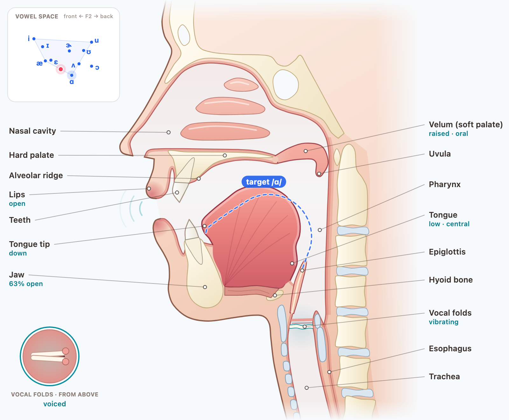

# Vocal Tract Formant Tracker

A real-time English vowel practice app. Speak into your microphone and watch a
**mid-sagittal vocal tract** move — tongue, jaw, lips, soft palate and vocal folds —
against native-speaker targets (Hillenbrand et al., 1995).

**Use it live (GitHub Pages):** open this repository’s Pages URL after deployment
(`https://<your-username>.github.io/vocal-tract-formant-tracker/`).



## Quick start (local)

```bash
python3 -m http.server 8000
# open http://localhost:8000/
```

Microphone and camera need `https` or `localhost` (not `file://`).

## What’s new in this version (Nov 2026)

The figure is an articulatory model, not a static plate: the tongue, jaw, lips, velum and
vocal folds move with your speech. Pick a target vowel to see its tongue as a dashed outline.

This is a new public site, separate from any earlier “vowel-formant-tracker” Pages deployment.

## Files

| File | Role |
|------|------|
| `index.html` | The whole app (HTML + CSS + JS) |
| `lip-lab.html` | Optional camera lip/jaw probe |
| `preview.png` | Illustration for this README |

No build step, no backend. Optional camera mode loads MediaPipe from a CDN the first time.
